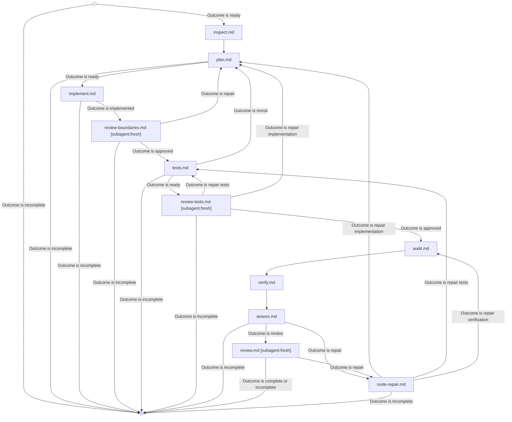

## Notes

- Use `jdeurt-meta:graph-workflows` to navigate this graph. It requires Python 3 for its CLI.
- Pass Task, Context, Plan, Candidate, Checks, and checkpoint Reviews as explicit artifacts. Each node preserves supplied artifacts.
- Use an accessible source checkout and its configured check tools. Record unavailable tools and unsupported source formats.
- Read [the design basis](research/basis.md) when checking provenance, detector claims, or changes to this workflow's policy.
