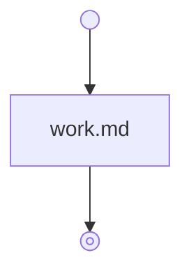

# Workflow format: mermaid-v1

Keep ordinary skill frontmatter with name and description. Set the string `metadata.workflow: mermaid-v1`. Skills without this marker retain ordinary behavior.

## Entry layout

Put one Mermaid fence first in the body. Only optional `## Notes` bullets follow it. Notes provide execution context, never hidden transitions or substitutes for declared node inputs.

````markdown
---
name: sample
description: Return a result from supplied facts.
metadata:
  workflow: mermaid-v1
---



## Notes

- Execute with jdeurt-meta:graph-workflows.
````

## Nodes and Markdown

Use `flowchart TD`. Declare each node once on its own line. Identifiers use letters, digits, and underscores, starting with a letter or underscore.

| Node           | Declaration                                     | Target                     |
| -------------- | ----------------------------------------------- | -------------------------- |
| Start          | `_start@{ shape: sm-circ, label: "Start" }`     | `steps/_start.md`          |
| Stop           | `_stop@{ shape: framed-circle, label: "Stop" }` | `steps/_stop.md`           |
| Ordinary file  | `draft["draft.md"]`                             | `steps/draft.md`           |
| Ordinary skill | `review["jdeurt-meta:evidence-review"]`         | Installed skill identifier |
| Fork or join   | `split@{ shape: fork, label: "Fork or Join" }`  | `steps/split.md`           |

Special shapes resolve `steps/<identifier>.md` in their skill. Ordinary node labels contain either a Markdown filename within that same steps directory or a `plugin:skill-name` identifier. The skill target can be an ordinary prose skill or a workflow. No hyperlinks, relative graph paths, wrapper files, or separate call type are needed.

Each file must stand alone with its purpose, required inputs, instructions, and returned outputs. Use headings when helpful. Prior results flow only through explicitly supplied artifacts. Do not depend on another node's prose, reasoning, history, or “as above” references. The validator checks declared references. An agent reviews semantic self-containment.

The start file's Inputs bullets define public inputs. The stop file's Outputs bullets define public outputs. The stop file can contain Output template with one relative Markdown link. Resolve it relative to that file. Fill templates as text without evaluating code.

These expanded shapes require Mermaid 11.3.0 or later. See [the source evidence](evidence.md).

## Edges and decisions

Use `source --> target` for an unconditional edge. Use `source -->|condition| target` for a conditional edge. A source cannot mix unconditional and conditional outgoing edges. Multiple unconditional edges require an explicit fork. Arrows and labels never imply fork/join behavior by themselves.

At an ordinary node, follow its unconditional edge or assess every outgoing condition. Select exactly one true condition when all others are false. Unknown or missing assessments block for evidence. Multiple true conditions block for ambiguity. No true condition blocks for clarification. Textual order gives no priority.

Conditions are plain text without pipes, quotes, backticks, backslashes, braces, or HTML delimiters. Use one declaration or edge per line. Blank lines and comments starting `%% ` are allowed. Other Mermaid directives, handlers, HTML, and executable content are outside this dialect. The CLI parses text without loading Mermaid.

Every node must be reachable from _start and have a structural route to _stop. _start has no incoming edges. _stop has no outgoing edges. Duplicate node declarations, branch targets, and ordinary conditions are invalid. Natural-language truth, exclusivity, and completeness require agent judgment. Static reachability does not prove task termination.

## Node context and nested workflows

Put one of these exact Mermaid comments immediately above a node declaration:

```text
%% subagent:fresh
review["jdeurt-meta:evidence-review"]
%% subagent:inherit
clarity["clarity.md"]
```

No annotation means continue on the same thread executing that path. Subagent:fresh prefers a separate agent without conversation history. Subagent:inherit prefers a separate agent with the context the harness can inherit. The comment belongs to the immediately following node, not to an edge or another comment. Blank lines do not change that association. There is no explicit main annotation or node identifier inside the comment.

These are execution guidelines. Use the closest supported behavior when subagents, context control, inheritance, or parallelism are unavailable. Execute all requested work. No routine capability disclaimer is required. Never claim context or concurrency that did not occur. Supply declared inputs and necessary instructions in every mode. A fresh preference passes those materials without full history.

For a skill identifier, resolve the installed plugin and skill and execute its own instructions. Match available artifacts to its declared inputs or task needs. Return its declared outputs as explicit artifacts. If the mapping is missing or ambiguous, resolve that before execution. No workflow marker is required for a prose skill.

For workflow targets, suspend the parent while the child executes from _start through _stop. Retain successful returned outputs, then assess the parent's outgoing conditions. Propagate blocked or failed skill execution before branch selection. Never invent missing outputs. Recursive skill references are allowed. Validation caches locally resolved resources.

## Explicit fork and join

The same Mermaid fork shape represents both roles. A fork file has `## Fork` with its paired join identifier on one line. A join file has `## Join` with its paired fork identifier. Pair them reciprocally.

A fork's Branches bullets map each direct target's inputs and returned outputs: `- review: supply Candidate and Evidence. Collect Verdict and Reasons.` Only the target prefix is machine-readable. Mapping meaning remains agent judgment.

For conditional fork edges, assess all conditions before dispatch and run every true branch. Unknown conditions block dispatch. No eligible branch blocks dispatch. With unlabeled outgoing edges, run every branch unconditionally.

Execute selected branches concurrently with separate agents when available, following their agent preferences. Supply each branch's declared inputs, relevant node files and Notes, paired join, and authorized effect ownership. Keep branch artifacts separate. Coordinate conflicting shared effects before dispatch.

If the harness cannot follow placement or parallelism preferences, execute the closest supported arrangement, including sequential inline work. Keep branch artifacts separate. Do not skip work or claim capabilities that were unavailable.

Each branch executes until its paired join and returns its state and declared outputs. The coordinator waits for all selected branches, then executes the join once. Unselected branches require no result. Merge outputs through declared mappings. Ambiguous artifact collisions block.

A blocked or failed branch blocks or fails the join unless its instructions define authorized recovery. Preserve other branch outcomes and completed effects. Cancel outstanding work when supported and appropriate. Check uncertain effects before repeating them. Never continue as though every branch succeeded.

Branches stay separate before their join. Reject cross-branch entry, overlaps, and join bypasses. Nested fork/join regions are permitted. Ordinary conditions within each branch keep their usual selection rule.

## References and recovery

A Markdown filename resolves only within its owning skill's steps directory. A skill identifier resolves through the installed plugin registry. In a source checkout, the CLI can resolve the current plugin's skills or a supplied plugin collection root. It accepts authored source directory names and their built jdeurt- namespaces. Regular skills need no workflow graph.

For local checking, pass the common skills directory, plugin directory, or plugin collection with `--root`. Files and physical link targets remain within that root. Without a resolvable plugin namespace, the CLI lists the identifier for installed resolution. It does not claim that dependency was validated. A missing skill in a known local plugin is a broken reference. Execution requires the actual skill to be available.

Output-template references resolve relative to the stop file. Distribute templates and locally required skills together. Validation does not prove service availability or natural-language input/output mappings.

Retain the current node, explicit artifacts, selected branches, call/return state, condition evidence, and completed effects as needed. Execute _stop's content before returning its declared outputs. Cycles and recursive execution follow their conditions and the authorized task. The format adds no execution caps or count-reporting requirement.

There are no implicit retries. Missing inputs and ambiguous conditions block. Instruction or tool errors fail. Inspect uncertain external outcomes before retrying. Respect existing authorization and denial rules. Resume valid checkpoints after resolving the cause. Report actual results, completed effects, and recovery actions without inventing success.
